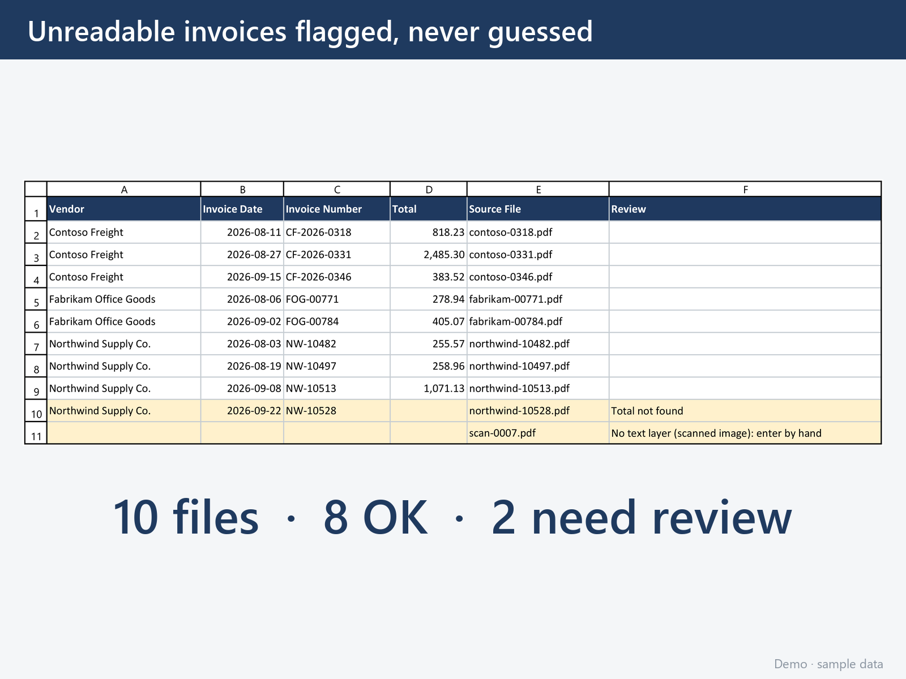

# Invoice PDF to spreadsheet extractor

Reads every PDF invoice in a folder and writes one spreadsheet row per invoice; anything it cannot read with certainty is flagged for review, never guessed.



## What it does

- One command turns a folder of PDF invoices into a spreadsheet: Vendor, Invoice Date, Invoice Number and Total, plus the Source File and a Review column.
- A field it cannot read with certainty is left blank, the row is highlighted, and the Review column says why ("Total not found", "No text layer (scanned image): enter by hand"). A person only has to look at the flagged rows.
- Vendor layouts live in a small text file (`vendors.toml`); a new vendor is a few lines, not a code change.

## Demo

**Every vendor, customer, address, invoice number and amount in `samples/` is invented** (the vendors are "Contoso Freight", "Fabrikam Office Goods" and "Northwind Supply Co."). Windows or any OS with Python 3.11 or newer; about three minutes, everything installs into this folder only:

```powershell
python -m venv .venv
.\.venv\Scripts\python.exe -m pip install -r requirements.txt
.\.venv\Scripts\python.exe extract.py samples output\invoices.xlsx
```

It prints:

```text
10 files, 8 OK, 2 need review
  REVIEW  northwind-10528.pdf: Total not found
  REVIEW  scan-0007.pdf: No text layer (scanned image): enter by hand
Saved output\invoices.xlsx
```

Open `output\invoices.xlsx`: eight clean rows and two highlighted ones. The two problem files are deliberate: `northwind-10528.pdf` stops at "Continued on next page" so it has no total, and `scan-0007.pdf` is a picture of an invoice with no text layer. Point the same command at any other folder of PDFs: `extract.py <pdf_folder> <output.xlsx>`.

## How it's built

- **Python 3.11+, two libraries:** pdfplumber reads the PDF text, openpyxl writes the spreadsheet.
- **Never-guess rules, in one place** (`parse_invoice` and `single_match` in `extract.py`): no text layer, no matching vendor layout, more than one matching layout, a pattern that finds nothing or two different values, a date or amount that does not parse: in every case the field stays blank and the Review column says which rule fired.
- **Layouts as data.** Each vendor in `vendors.toml` is a match string plus one anchored pattern per field and a date format. The tests pin the expected values for every sample.
- **Reproducible samples.** `generate_samples.py` rebuilds the 10 sample PDFs exactly, so the test data is code, not files someone once had.
- **Read-only inputs, no network, no credentials.** PDFs are only read; the output file is rebuilt on every run and is not kept in git.

How to add a vendor or a column, the limits (text PDFs only, no OCR), the screenshot tooling and the dependency licences are in [`docs/DETAILS.md`](docs/DETAILS.md).

## Tests

```powershell
.\.venv\Scripts\python.exe -m pip install -r requirements-dev.txt
.\.venv\Scripts\python.exe -m pytest -v
```

The tests run the extractor over `samples/` and check the expected Vendor, Date, Number and Total for every clean invoice, that both problem files are flagged with the right reason, and the never-guess rules one by one. Current run (2026-11-04): **27 passed.**

## Built by AZG Engineering

Built by [AZG Engineering](https://azgengineering.com), small automations for small businesses and public-sector teams.

## Licence

Copyright © 2026 Azimuth Group LLC. All rights reserved. Published as a work sample; no licence to reuse it is granted. The Inter font in `tools\fonts\` is under the SIL Open Font License 1.1 (`tools\fonts\OFL.txt`).
